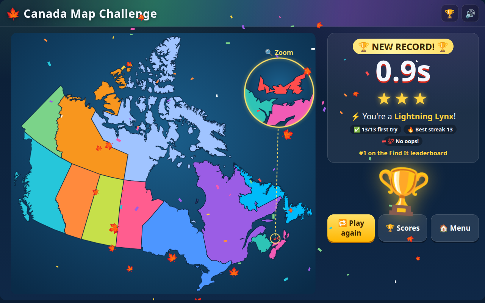

# 🍁 Canada Map Challenge

A fast, colourful map quiz on Canada's **10 provinces, 3 territories and their capitals**, made for a grade 4 geography test.

**▶ Play it: https://drewsipher.github.io/canada-map-challenge/**



## How it plays

| Mode | What you do |
| --- | --- |
| 🗺️ **Find It** | A name appears. Tap that province or territory on the map. |
| 🏷️ **Name It** | A province glows. Pick its name. |
| ⭐ **Capitals** | A province glows. Pick its capital city. |
| 🔎 **Explore** | No clock. Tap anywhere to learn the capital and a fun fact. |

- **Your time is your score.** All 13 come up in random order each round.
- **No wild guessing:** a wrong answer adds +5 s, then +8 s, then +11 s on the same question, and freezes you for a second while the clock keeps running.
- Stars, streaks, a Canadian-animal rank (Lightning Lynx, Busy Beaver, Mighty Moose, Brave Bear), confetti, and a top-8 leaderboard per mode.
- A zoom circle makes tiny P.E.I. easy to tap.
- Works on phones, tablets and desktops. Sound effects are generated in the browser, and there's a mute button.

High scores are saved in the browser you play on (localStorage), so each device has its own leaderboard.

## Use it yourself

It's a single file with no dependencies: [`canada-map-challenge.js`](canada-map-challenge.js).

```html
<canada-map-challenge></canada-map-challenge>
<script src="canada-map-challenge.js"></script>
```

### Home Assistant

It also works as a Lovelace card. Copy `canada-map-challenge.js` to `/config/www/`, add `/local/canada-map-challenge.js` as a **JavaScript module** resource, then add a panel view with:

```yaml
type: custom:canada-map-challenge
player: Alex   # optional default player name
```

To share high scores between devices, create three text helpers (max length 255): `input_text.canada_map_challenge_find`, `input_text.canada_map_challenge_name` and `input_text.canada_map_challenge_capitals`. Without them, scores stay in each browser. To reset a leaderboard, set its helper to empty.

## Development

The game lives in `src/` and is bundled into one file:

```sh
python3 tools/build.py        # src/card.src.js + src/style.css + src/map.json -> canada-map-challenge.js
```

`src/map.json` holds pre-projected SVG outlines (Lambert conformal conic, as Statistics Canada uses) and capital-city positions. To regenerate it, download [`canada.geojson`](https://github.com/codeforgermany/click_that_hood/blob/main/public/data/canada.geojson) and run:

```sh
python3 tools/mkmap.py canada.geojson src/map.json
```

## Credits

- Province and territory boundaries: [click_that_hood](https://github.com/codeforgermany/click_that_hood) (MIT).
- Everything else: MIT, see [LICENSE](LICENSE).
